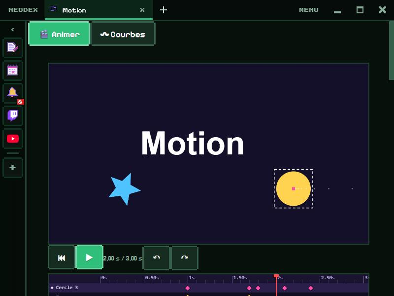

# Motion

Animate shapes, text and images with keyframes, then export as a video or as HTML/CSS. And tune your own animation curves.

*Version française : [README.md](README.md)*

## Animate

- **Layers**: rectangle, circle, triangle, star, text (6 fonts, several lines, outline) and images (🖼 button or drop a file). ▲ ▼ for the order, duplicate, delete, ● in the timeline to hide a layer.
- **7 animatable properties**: X, Y, scale, rotation, opacity, blur and colour. With **● Auto**, every change sets a keyframe at the current time; **◇ / ◆** sets or removes a key by hand.
- **In the scene**: click a layer to pick it, drag it to move it; its path shows as dots.
- **Timeline**: one row per layer and, for the picked layer, one row per property. Click the ruler to move in time, drag the diamonds to move keys (a layer key moves all its properties at once).
- **Easing** of each key: the 10 presets, your 3 curves from the Curves mode (Bézier or spring), or "Jump".
- **12 ready-made effects**: fade in, fade out, enter from the left or the right, drop with a bounce, pop, pulse, shake, full turn, blur to sharp, colour change, float.
- **Scene**: landscape 16:9, portrait 9:16 or square, background colour, length from 0.5 to 30 s, looping or once.
- **Export**: **WebM** video at 1280×720 (or 720×1280, 960×960), **HTML + CSS** to copy or a full **.html** page (images included), **PNG** image of the current time.
- Space: play · Delete: erase · arrows: move (Shift: ×10) · Ctrl+Z / Ctrl+Y: undo / redo.

## Curves: three curves to compare

Pink, blue and yellow: click a curve to tune it, **◉ / ○** to show or hide it in the preview. The preview plays them side by side on 4 properties: a move, a scale, a rotation and a fade. **▶ Replay**, the **duration** (200 ms to 4 s), **looping** or **once**.

## Bézier

Drag the two handles on the graph, or type their values. A handle above 1 or below 0 makes the animation overshoot (a bounce, a wind-up). 10 presets (the CSS ones, plus back, wind-up, fast, gentle, sharp), and **★ Keep** adds your curve to the list.

## Spring

Mass, stiffness, damping and initial velocity: little damping, it bounces; a lot, it glides without overshooting. The duration is the spring's time to rest.

## The CSS

Ready to copy: a `transition` and a `@keyframes` with the curve. Bézier gives `cubic-bezier(…)`; the spring gives `linear(…)`, its curve sampled at 41 points (Chrome 113+, Firefox 112+, Safari 17.2+).

## Data

The animation, its images, the 3 curves, the duration and your presets are kept in the plugin folder. Permission: `storage` only.
