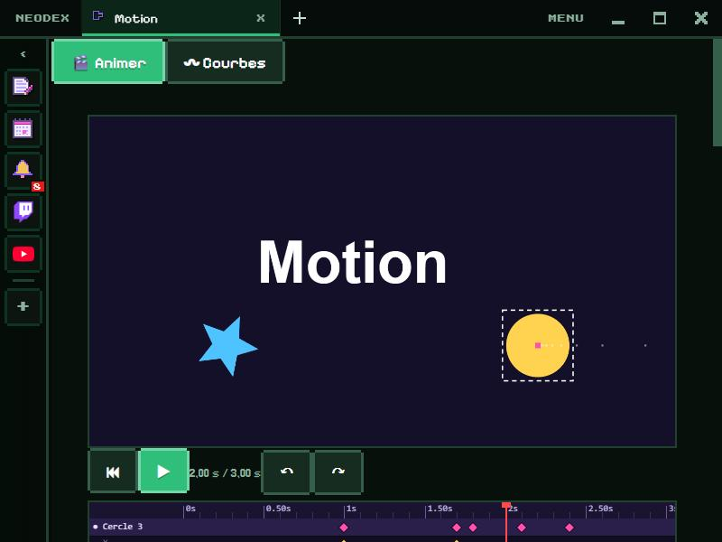

# Motion

Anime des formes, des textes et des images avec des images clés, puis exporte en vidéo ou en HTML/CSS. Et règle tes propres courbes d'animation.

*English version: [README.en.md](README.en.md)*

## Animer

- **Calques** : rectangle, cercle, triangle, étoile, texte (6 polices, plusieurs lignes, contour) et images (bouton 🖼 ou glisser un fichier). ▲ ▼ pour l'ordre, dupliquer, supprimer, ● dans la timeline pour cacher un calque.
- **7 propriétés animables** : X, Y, échelle, rotation, opacité, flou et couleur. En mode **● Auto**, chaque changement pose une image clé à l'instant présent ; **◇ / ◆** pose ou retire une clé à la main.
- **Dans la scène** : clique un calque pour le choisir, glisse-le pour le déplacer ; son trajet s'affiche en pointillés.
- **Timeline** : une ligne par calque et, pour le calque choisi, une ligne par propriété. Clique la règle pour te placer, glisse les losanges pour déplacer les clés (une clé du calque déplace toutes ses propriétés à la fois).
- **Accélération** de chaque clé : les 10 préréglages, tes 3 courbes du mode Courbes (Bézier ou ressort), ou « Saut ».
- **12 effets tout prêts** : apparition, disparition, entrée par la gauche ou la droite, chute avec rebond, surgir, pulsation, secousse, tour complet, flou vers net, changement de couleur, flottement.
- **Scène** : paysage 16:9, portrait 9:16 ou carré, couleur du fond, durée de 0,5 à 30 s, en boucle ou une fois.
- **Export** : vidéo **WebM** en 1280×720 (ou 720×1280, 960×960), **HTML + CSS** à copier ou page **.html** complète (images comprises), **image PNG** de l'instant présent.
- Espace : lecture · Suppr : effacer · flèches : déplacer (Maj : ×10) · Ctrl+Z / Ctrl+Y : annuler / refaire.

## Courbes : trois courbes à comparer

Rose, bleue et jaune : clique sur une courbe pour la régler, **◉ / ○** pour la montrer ou la cacher dans l'aperçu. L'aperçu les joue côte à côte sur 4 propriétés : un déplacement, un agrandissement, une rotation et un fondu. **▶ Rejouer**, la **durée** (200 ms à 4 s), **en boucle** ou **une fois**.

## Bézier

Glisse les deux poignées sur le graphique, ou tape leurs valeurs. Une poignée au-dessus de 1 ou sous 0 fait dépasser l'animation (un rebond, un élan). 10 préréglages (ceux du CSS, plus retour, élan, rapide, doux, brusque), et **★ Garder** ajoute ta courbe à la liste.

## Ressort

Masse, raideur, amortissement et vitesse de départ : peu d'amortissement, ça rebondit ; beaucoup, ça glisse sans dépasser. La durée est celle du ressort jusqu'au repos.

## Le CSS

Prêt à copier : une `transition` et une `@keyframes` avec la courbe. Bézier donne `cubic-bezier(…)` ; le ressort donne `linear(…)`, sa courbe échantillonnée en 41 points (Chrome 113+, Firefox 112+, Safari 17.2+).

## Données

L'animation, ses images, les 3 courbes, la durée et tes préréglages sont gardés dans le dossier du plugin. Autorisation : `storage` seulement.
